# Diagrama entidad-relación — VisiÓptica

Generado desde las llaves foráneas reales de la base (25-11-2026). Se ven en GitHub o en cualquier visor de Mermaid.

Para no saturar el dibujo, aquí van las tablas principales del negocio; las demás (catálogos de ubicación, logs, tablas de Laravel) están en el [diccionario de datos](DICCIONARIO_DATOS.md).

```mermaid
erDiagram
    formula_medica |o--o{ agendamiento_procedimiento : "id_formula"
    historia_clinica |o--o{ agendamiento_procedimiento : "id_historia_clinica"
    tipo_terapia ||--o{ agendamiento_procedimiento : "id_tipo_terapia"
    estado ||--o{ asignacion_cita : "id_estado"
    motivos_cita |o--o{ asignacion_cita : "id_motivo"
    optometra ||--o{ asignacion_cita : "id_optometra"
    tipo_cita ||--o{ asignacion_cita : "id_tipo_cita"
    usuario ||--o{ asignacion_cita : "id_usuario"
    empresa |o--o{ asignacion_cita : "nit_empresa"
    estado ||--o{ carrito : "id_estado"
    usuario ||--o{ carrito : "id_usuario"
    estado ||--o{ categoria_producto : "id_estado"
    empresa |o--o{ categoria_producto : "nit_empresa"
    carrito ||--o{ detalle_carrito_producto : "id_carrito"
    producto ||--o{ detalle_carrito_producto : "id_producto"
    pedido ||--o{ detalle_pedido_producto : "id_pedido"
    producto ||--o{ detalle_pedido_producto : "id_producto"
    producto ||--o{ detalle_venta_producto : "id_producto"
    venta ||--o{ detalle_venta_producto : "id_venta"
    enfermedades |o--o{ diagnostico : "id_enfermedad"
    formula_medica |o--o{ diagnostico : "id_formula"
    historia_clinica |o--o{ diagnostico : "id_historia_clinica"
    empresa |o--o{ enfermedades : "nit_empresa"
    empresa |o--o{ especialidad : "nit_empresa"
    agendamiento_procedimiento ||--o{ evolucion_terapia : "id_agendamiento_procedimiento"
    usuario ||--o{ formula_medica : "documento_paciente"
    optometra |o--o{ formula_medica : "doc_optometra"
    asignacion_cita ||--o| historia_clinica : "id_asignacioncita"
    diagnostico |o--o{ historia_clinica : "id_diagnostico"
    formula_medica |o--o{ historia_clinica : "id_formula"
    optometra |o--o{ horario : "id_optometra"
    empresa |o--o{ horario : "nit_empresa"
    plan ||--o{ licencia : "id_plan"
    empresa ||--o{ licencia : "nit_empresa"
    estado ||--o{ lote : "id_estado"
    producto ||--o{ lote : "id_producto"
    empresa |o--o{ lote : "nit_empresa"
    estado ||--o{ marca : "id_estado"
    empresa |o--o{ marca : "nit_empresa"
    empresa |o--o{ motivos_cita : "nit_empresa"
    especialidad |o--o{ optometra : "id_especialidad"
    estado ||--o{ optometra : "id_estado"
    tipo_documento ||--o{ optometra : "id_tipo_docu"
    empresa ||--o{ optometra : "nit_empresa"
    estado ||--o{ pedido : "id_estado"
    proveedor ||--o{ pedido : "id_proveedor"
    usuario ||--o{ pedido : "id_usuario"
    empresa |o--o{ pedido : "nit_empresa"
    categoria_producto |o--o{ producto : "id_categoria"
    estado ||--o{ producto : "id_estado"
    marca |o--o{ producto : "id_marca"
    empresa |o--o{ producto : "nit_empresa"
    empresa |o--o{ proveedor : "nit_empresa"
    usuario |o--o{ simulacion_visual : "documento_paciente"
    historia_clinica |o--o{ simulacion_visual : "id_historia_clinica"
    optometra ||--o{ simulacion_visual : "id_optometra"
    empresa |o--o{ tipo_cita : "nit_empresa"
    empresa |o--o{ tipo_terapia : "nit_empresa"
    estado ||--o{ usuario : "id_estado"
    rol ||--o{ usuario : "id_rol"
    tipo_documento ||--o{ usuario : "id_tipo_docu"
    empresa |o--o{ usuario : "nit_empresa"
    estado ||--o{ venta : "id_estado"
    usuario ||--o{ venta : "id_usuario"
    empresa |o--o{ venta : "nit_empresa"
```

